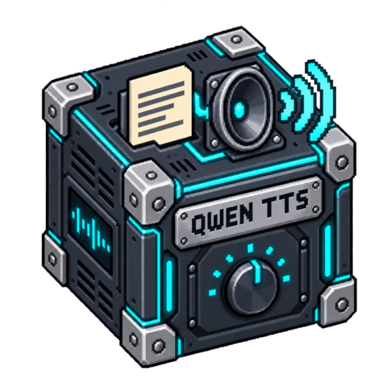

# Qwen3 TTS

[](media/cover.png)

<!-- block-metadata:start -->
[](model.json)
[](compatibility.json)
[](LICENSE)

Verified BloxSmith versions: **1.0.9** (bundled-block tests; see [test evidence](compatibility.json)).
<!-- block-metadata:end -->

Generate complete speech files **locally**, using the pinned
**Qwen3-TTS-12Hz-1.7B-CustomVoice** model and its Python SDK in a separate process.
No speech API, API key or reference recording is required. **Actual model
qualification is pending**; adapter tests use an explicitly synthetic model process.

## Prepare the local model

Requirements: Linux, Python 3.10+ for the block, FFmpeg on PATH, a dedicated
Python inference environment and adequate RAM/VRAM. CUDA is recommended;
CPU execution is explicit and may exceed the request deadline. Missing CUDA
does not silently select CPU. Do not assume this 1.7B model fits a small board.

1. Install `requirements.txt` into a separate Python environment. Select matched
   Torch/torchaudio CPU or CUDA wheels for the host. The Qwen SDK is installed
   from an immutable Git commit. Nothing is installed by the block itself.
2. Inspect the required local assets:

   ```sh
   python setup_model.py --directory MODEL_DIRECTORY
   ```

   This is read-only. To explicitly download the public pinned snapshot:

   ```sh
   python setup_model.py --directory MODEL_DIRECTORY --download-public
   ```

   The helper checks free disk first and preserves existing files. The model,
   bundled speech tokenizer and text files require **4,520,159,586 bytes**,
   before dependencies, working space and RAM/VRAM. One additional GiB is required
   by the helper's disk preflight. Corrupt cached files are refused, not overwritten.
3. Configure **Model asset directory** and **Inference Python executable**.
   An empty executable uses the application interpreter, which usually does not
   contain the separate model environment. The configured executable is trusted
   local code, not an OS sandbox.

Model files are verified before each load. Do not modify a prepared snapshot while
it is being used. Each text activation loads the model in its own supervised
process; it is **not** a warm persistent model server. Run preparation performs no
inference or download. The child uses offline Hugging Face settings, disables
telemetry, strips unrelated environment variables and refuses remote model code.

## Connect it

| Port | Contract |
| --- | --- |
| `text` input | Plain speech text, or `{ "text": "Hello", "request_id": "turn-1" }` with `application/json` MIME. |
| `command` input | Exactly `{ "action": "interrupt" }`. |
| `audio_file` output | Path to one complete WAV or Ogg/Opus file. |
| `metadata` output | Request ID, model/SDK revisions, generation settings, EOS, duration, format, bytes and SHA-256. |
| `status` output | Completion, interruption, queue rejection or safe recoverable error. |

Plain strings resembling JSON remain speech text. A command does not replay cached
text. If text and interrupt arrive in the same activation, interrupt wins. Explicitly
repeating a request ID is a new synthesis; no durable deduplication is promised.

The default output is **mono Ogg/Opus at 48 kHz**; WAV is native mono PCM16 at 24 kHz.
There is **no audio_stream port**: these are complete files, not live streaming.
Empty output directory uses the node's persistent `audio/` directory. Relative
configured paths resolve against the application root. Publication is atomic with
unique names; previous files are never overwritten or automatically deleted.

## Voice and language

CustomVoice offers nine built-in speakers: Ryan, Aiden, Vivian, Serena, Uncle_Fu,
Dylan, Eric, Ono_Anna and Sohee. Select one in the modal or inspector. Supported
language settings are Auto, English, French, German, Spanish, Italian, Portuguese,
Russian, Chinese, Japanese and Korean. The language setting does not translate text.
An optional **voice style instruction**, up to 512 characters, influences delivery.
It does not guarantee exact timing, pronunciation or speaker identity.

This block intentionally uses CustomVoice, not the Base voice-cloning model or the
separate VoiceDesign checkpoint. No reference voice is uploaded or cloned.

## Execution and limits

Both One Shot Simulation and Active Runtime perform actual local inference when
text executes. Simulation is not an inference-free preview. Active Runtime listens
for explicit commands, with one active job and a bounded FIFO (four pending requests
by default). Zero pending capacity rejects new texts while busy; `queue_full` never
silently drops accepted text. Framework queues are separate.

Interrupt terminates the owned local process group, discards its unfinished audio
and clears older pending texts. The listener remains available for later requests.
Stop and abrupt host termination also fence owned processes. A forcibly terminated
host may leave a private unfinished job directory, never published as an audio result.
Previously completed files and downstream players remain unchanged; interrupt the
player separately if needed.

The high-level Qwen SDK can return audio when its token budget is exhausted. The
block therefore observes the pinned SDK's underlying generation result and requires
the real EOS token before accepting the waveform. This observer is instance-local
and restores the original method; upstream files are not changed. EOS is a technical
completion signal, not proof that every requested word was pronounced correctly.
Invalid, silent, overlong or non-finite audio is refused rather than truncated.

Main settings expose assets, interpreter, destination, voice, language, style,
device and format. Advanced settings include temperature (0.1–2), top-k (1–500),
top-p (0.01–1), repetition penalty (0.1–2), CPU threads (1–16), accepted audio
duration (1–90 seconds), generated-token cap (16–4096), text limit (1–2000 characters,
also 8192 UTF-8 bytes), deadline (1–240 seconds) and pending capacity (0–16).
The actual token cap is also bounded by the duration setting. The separate
sub-talker uses the pinned model's defaults; it has no invented voice-control knobs.

The deadline includes asset verification, loading, synthesis, encoding and
publication. Default available-RAM preflight is 16 GiB (minimum 8 GiB). It is not
a reservation or a guarantee about VRAM. An optional Linux address-space limit
accepts 0 (disabled, default) or 4096–262144 MiB; CUDA may reserve large virtual
ranges, so address space must not be confused with physical memory consumption.

Modal and inspector share English/French draft settings, associated labels,
keyboard tabs, validation and responsive layouts. Apply saves; Cancel discards.
Stop and reload an already prepared Run after changing settings.

## Verification and provenance

- Model snapshot: `0c0e3051f131929182e2c023b9537f8b1c68adfe`.
- Official Qwen SDK: `022e286b98fbec7e1e916cb940cdf532cd9f488e` (package 0.1.1).
- Model artifacts and exact size/hash declarations: `model_artifacts.json`.

Package suites exercise the SDK adapter with explicit doubles, asset integrity,
real supervised processes and FFmpeg codecs, EOS refusal, queue/interruption races,
both runtimes and bundled/managed/linked packaging, and responsive translated UI.
They do not certify actual Qwen speech quality, latency, GPU use or language accuracy.
The proprietary framework test harness and model assets are not distributed here.

An optional real-model probe is read-only by default:

```sh
python tests/qualify_model.py --directory MODEL_DIRECTORY --python INFERENCE_PYTHON
```

Add `--execute --results-directory DISPOSABLE_DIRECTORY` only after preparing the
environment and model. It synthesizes short English/French examples, saving complete
audio and reporting metadata. Listen to the results; a protocol check is not a
speech-quality evaluation. The probe never downloads weights or installs software.

## License

Block-owned code is Apache-2.0. The official Qwen SDK and this model are also
identified upstream as Apache-2.0; review their respective notices when deploying
or redistributing them. Neither model weights nor SDK source are bundled here.

References: [official Qwen3-TTS repository](https://github.com/QwenLM/Qwen3-TTS),
[CustomVoice model card](https://huggingface.co/Qwen/Qwen3-TTS-12Hz-1.7B-CustomVoice).
